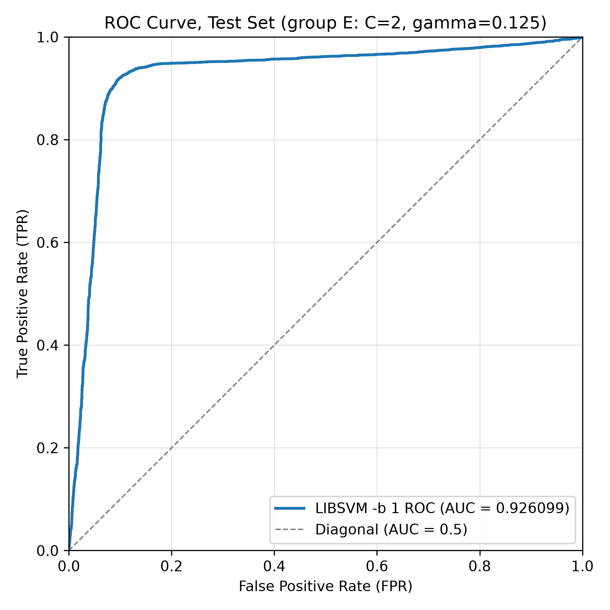

# 資料探勘作業二 Q4：ROC Curve 與 AUC

## 1. 選用哪個模型？如何用 -b 1 重訓並取得每筆測試資料的機率？

選用 Q3 選出的 E 組參數（C-SVC、RBF kernel、C = 2、gamma = 0.125），模型與 Q3 最終重訓相同。

- 輸入沿用 Q3 最終重訓的縮放檔 [train.scaled](q3_outputs/final/train.scaled)（40,000 筆）與 [test.scaled](q3_outputs/final/test.scaled)（10,000 筆）；縮放規則 [scale_range.txt](q3_outputs/final/scale_range.txt) 僅由 training 建立。
- 訓練指令：`svm-train.exe -s 0 -t 2 -c 2 -g 0.125 -b 1 -q train.scaled M_prob_E.model`，產生 [M_prob_E.model](q4_outputs/models/M_prob_E.model)。
- 預測指令：`svm-predict.exe -b 1 test.scaled M_prob_E.model P_prob_E.txt`，產生 [P_prob_E.txt](q4_outputs/predictions/P_prob_E.txt)。輸出第一行為 `labels 0 1`，之後每行為預測類別與兩個類別的機率。
- 真實標籤是從同一份 test.scaled 逐行讀取，並與 [split.csv](q2_outputs/split.csv) 的 test 標籤逐行核對，結果一致。
- 自算 Accuracy 為 90.82%（9082/10000），與 svm-predict 輸出一致。此值略低於 Q3 最終模型的 90.86%，原因是 `-b 1` 時 LIBSVM 依機率估計決定預測類別，與 Q3 以決策值判斷的結果不同。
- 每筆測試資料的正類機率與逐筆對照已存於 [test_probabilities.csv](q4_outputs/test_probabilities.csv)。

## 2. ROC 曲線如何繪製？正類、門檻、同分處理及兩軸如何定義？

- **正類**：標籤 1，表示第一隻寶可夢獲勝。分數為 `labels` 標頭中類別 1 所在欄位的機率，程式依標頭查找，不假設欄位順序。
- **門檻**：將 10,000 筆測試資料依正類機率由高到低排序。起點為 (0, 0)，門檻由高往低逐步降低。
- **同分處理**：機率值相同的樣本整批納入後，才更新累計 TP、FP 並記錄一個 ROC 點，避免同分樣本產生人為的階梯。
- **橫軸 FPR** = 累計 FP / 實際負類總數（5280）。
- **縱軸 TPR** = 累計 TP / 實際正類總數（4720）。
- 曲線最後到達 (1, 1)，且 FPR、TPR 皆單調不減（已驗證，皆通過）。
- 本次共產生 9570 個 ROC 點（含起點），對應 9569 個不同機率值。座標檔為 [roc_points.csv](q4_outputs/roc_points.csv)。
- 繪圖以 Matplotlib 輸出 300 DPI 圖檔，包含 (0, 0) 到 (1, 1) 的對角參考線，圖例標示實際 AUC。



## 3. AUC 如何計算？實際 AUC 為何？

- **計算方式**：以相鄰 ROC 點的梯形面積累加，每段面積為 (FPR_next - FPR_current) × (TPR_next + TPR_current) / 2。程式以純 Python 實作，未使用 scikit-learn 或任何現成 ROC/AUC 函式。
- **精度**：計算過程保留原始浮點精度，報告顯示至小數點後六位。
- **獨立核對**：另以 Mann-Whitney 配對計數（正類分數大於負類計 1，同分計 0.5）計算一次 AUC，兩者差異約 $3 \times 10^{-15}$，判定為一致。
- **自我測試**（均通過）：完美排序 AUC = 1.0；完全反向 AUC = 0.0；正負類分數全部相同 AUC = 0.5。

**實際 AUC = 0.926099**（完整浮點值 0.9260992873651801）。

| 項目 | 數值 |
|---|---|
| 測試筆數 | 10,000 |
| 正類（標籤 1）筆數 | 4,720 |
| 負類（標籤 0）筆數 | 5,280 |
| ROC 點數（含起點） | 9,570 |
| AUC | 0.926099 |

AUC 結果檔為 [auc_summary.csv](q4_outputs/auc_summary.csv)。

## 4. ROC 圖與程式碼在哪裡？提供相對路徑和重現指令。

- ROC 圖：[q4_outputs/roc_curve.png](q4_outputs/roc_curve.png)（300 DPI）
- 程式碼：[q4_roc_auc.py](q4_roc_auc.py)
- 執行紀錄：[q4_outputs/run_log.txt](q4_outputs/run_log.txt)
- 其他輸出：[q4_outputs/models/M_prob_E.model](q4_outputs/models/M_prob_E.model)、[q4_outputs/predictions/P_prob_E.txt](q4_outputs/predictions/P_prob_E.txt)、[q4_outputs/roc_points.csv](q4_outputs/roc_points.csv)、[q4_outputs/test_probabilities.csv](q4_outputs/test_probabilities.csv)

重現指令（於 HW2 資料夾執行，LIBSVM 預設路徑為 libsvm\windows）：

```
python q4_roc_auc.py --libsvm-dir libsvm\windows
```

需要 Python 3 與 matplotlib。若 q3_outputs\final\ 內的縮放檔不存在，程式會依 q2_outputs\split.csv 重建縮放檔，並存放於 q4_outputs\scaled\。
